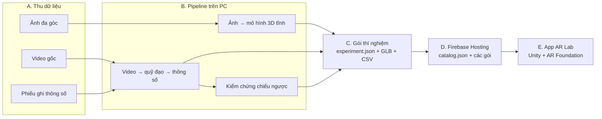

# AR Experiment — Tổng quan hệ thống

Cập nhật: 15/11/2026 · Phiên khởi tạo (Claude Fable 5.2)

Tài liệu này là điểm vào của dự án. Đọc xong sẽ biết hệ thống gồm những khối nào, dữ liệu đi từ đâu tới đâu, cái gì đã chốt và cái gì còn mở. Việc cụ thể theo giai đoạn nằm ở [Lộ trình](01-LO-TRINH.md); cách các agent phối hợp nằm ở [Quy ước đa agent](02-QUY-UOC-DA-AGENT.md).

## 1. Mục tiêu

Biến một thí nghiệm vật lí thật thành thí nghiệm AR trên điện thoại:

- Từ **ảnh chụp nhiều góc** dựng được mô hình 3D của bộ dụng cụ.
- Từ **video quay thí nghiệm** rút ra **thông số thật của hệ** (vị trí, vận tốc, chu kì, gia tốc… kèm sai số).
- Trong AR, người xem đi quanh bàn và thấy thí nghiệm ở **mọi góc nhìn, thống nhất và liền mạch** với thí nghiệm thật.
- **Một app cài một lần**; thí nghiệm mới được tải về như dữ liệu, không phải cài lại.

## 2. Bốn nguyên tắc thiết kế

1. **Đo thật rồi dựng lại.** Video là dụng cụ đo, không phải thứ đem chiếu cho người xem. Người xem thấy mô hình 3D chuyển động theo số liệu đo được.
2. **Một hệ toạ độ, một trục thời gian.** Mọi thứ (mô hình tĩnh, quỹ đạo, vị trí máy quay, ảnh đánh dấu trên bàn) quy về cùng một gốc toạ độ tính bằng mét và cùng một mốc `t = 0`. Vì mọi điện thoại vẽ cùng một cảnh 3D từ vị trí của mình, các góc nhìn tự khớp nhau; không cần nội suy giữa các video.
3. **Thí nghiệm là dữ liệu, không phải mã.** App chỉ là trình phát. Mỗi thí nghiệm là một gói file (mô hình + quỹ đạo + mô tả) theo [định dạng chung](05-DINH-DANG-GOI-THI-NGHIEM.md). Đây là điều kiện để cập nhật không cài lại.
4. **Con số nào cũng có nguồn gốc và sai số.** Gói thí nghiệm ghi rõ phiên quay, phương pháp, sai số chiếu ngược. Số liệu không truy được nguồn thì không đưa vào bản dùng cho giảng dạy.

## 3. Sơ đồ hệ thống

| Khối | Nằm ở đâu | Công cụ chính |
|---|---|---|
| A. Thu dữ liệu | Kho OneDrive `AR_experiment_website\01_Anh_Da_Goc`, `02_Video_Goc` | Điện thoại / action cam, bảng hiệu chuẩn, thước chuẩn |
| B. Pipeline | Repo `pipeline/`, vùng làm việc `work/` | Python + OpenCV, ffmpeg, RealityScan hoặc AI tạo 3D, Blender |
| C. Gói thí nghiệm | Repo `experiments/<mã>/` | JSON, GLB, CSV |
| D. Phân phối | Firebase Hosting | Firebase CLI / plugin Firebase |
| E. App | Repo `unity/` | Unity 6.3 LTS, AR Foundation, ARCore, glTFast |

Cấu trúc thư mục chi tiết: [Cấu trúc thư mục và dữ liệu](03-CAU-TRUC-THU-MUC-VA-DU-LIEU.md).

## 4. Khối B — hai nhánh xử lý

### B1. Ảnh nhiều góc → mô hình 3D tĩnh (giá đỡ, thước, bàn, dụng cụ)

| Cách | Đầu vào | Khi nào dùng | Giới hạn |
|---|---|---|---|
| Quét ảnh (photogrammetry) | 30–80 ảnh chồng lấn quanh bộ dụng cụ | Cần đúng hình dáng và kích thước | Kém với thuỷ tinh, kim loại bóng, chi tiết mảnh |
| AI tạo sinh (Meshy, Tripo) | 4 ảnh trước / trái / sau / phải | Vật đơn giản, cần nhanh | Kích thước và chi tiết nhỏ không bảo đảm |
| Dựng tay trong Blender | Số đo thật + ảnh tham chiếu | Vật tròn xoay, thuỷ tinh, dụng cụ có vạch chia | Tốn công |

Cả ba cách đều kết thúc bằng bước hậu kỳ trong Blender: đặt tỉ lệ thật (mét), gốc toạ độ, giảm lưới, xuất GLB.

### B2. Video → thông số của hệ

1. **Nhập liệu:** chép phiên quay từ kho OneDrive vào `work/`, giữ nguyên file gốc.
2. **Hiệu chuẩn máy quay:** thông số trong (tiêu cự, méo ống kính) và vị trí máy trong hệ toạ độ chung, bằng bảng hiệu chuẩn.
3. **Đồng bộ thời gian** (khi có nhiều máy): mốc đèn LED chớp hoặc tiếng vỗ.
4. **Theo dõi vật:** tìm vật trong từng khung hình (ngưỡng màu, tâm khối; vật phức tạp dùng mô hình theo dõi điểm).
5. **Ra toạ độ 3D:** nhiều máy thì giao các tia ngắm; một máy thì dùng mặt phẳng chuyển động đã biết + thước chuẩn.
6. **Khớp mô hình vật lí:** ví dụ `y = y₀ + v₀t − ½gt²`, ra thông số và sai số.
7. **Đóng gói** theo định dạng chung.
8. **Kiểm chứng:** chiếu cảnh dựng ngược về vị trí máy quay, chồng lên video gốc; độ lệch còn lại là sai số công bố.

## 5. "Từ một video ra mọi góc nhìn" — làm được tới đâu

| Con đường | Bản chất | Dùng cho | Đánh giá |
|---|---|---|---|
| **1. Đo – dựng lại** (đường chính) | Video cho quỹ đạo; cảnh 3D phát lại theo quỹ đạo | Vật rắn, chuyển động theo dõi được | Chính xác, kiểm chứng được. Một máy quay là đủ nếu chuyển động nằm trong một mặt phẳng đã biết (rơi tự do, con lắc, mặt phẳng nghiêng); chuyển động không phẳng cần từ 2 máy. |
| **2. Mô hình tham số** | Video cho thông số (chu kì, biên độ, bước sóng); app vẽ hiện tượng bằng công thức | Dao động, sóng, quang hình, mạch điện | Đúng về vật lí trong phạm vi mô hình; hình ảnh là hình vẽ, không phải ảnh thật |
| **3. Tái dựng 4D bằng AI** (thử nghiệm) | Gaussian splatting có thời gian, hoặc AI sinh góc nhìn mới | Chất lỏng, khói, lửa — thứ không có hình dạng cố định | Còn ở mức nghiên cứu; góc nhìn sinh ra có thể sai vật lí. Unity chưa hỗ trợ splat chính thức, plugin mở chưa bảo đảm chạy trên điện thoại. Không dùng làm thí nghiệm chuẩn. |

Phân loại thí nghiệm theo con đường áp dụng được:

| Nhóm | Ví dụ | Con đường |
|---|---|---|
| A. Vật rắn chuyển động | Rơi tự do, ném ngang, con lắc đơn, va chạm xe lăn, đòn bẩy | 1 |
| B. Hiện tượng mô tả bằng thông số | Con lắc lò xo, sóng dừng trên dây, giao thoa sóng nước, khúc xạ, mạch điện | 2 (kết hợp 1 cho phần dụng cụ) |
| C. Không có hình dạng cố định | Đối lưu, khuếch tán, sự sôi | 3, hoặc video phẳng đặt đúng vị trí máy quay |

Thí nghiệm mẫu đầu tiên: **rơi tự do** (nhóm A).

## 6. Khối E — App AR Lab

| Thành phần | Việc |
|---|---|
| Lõi AR | Dò mặt phẳng, neo cảnh vào ảnh đánh dấu trên bàn (AR Foundation + ARCore) |
| Trình tải gói | Đọc `catalog.json`, tải gói, lưu đệm để dùng khi không có mạng |
| Trình phát | Đặt mô hình tĩnh, chạy vật theo quỹ đạo; tốc độ thật, quay chậm, dừng từng khung |
| Lớp phủ | Vệt vị trí, vectơ vận tốc / lực, thước, đồ thị y(t), v(t), giá trị đo kèm sai số |
| Đồng bộ nhóm | Nhiều máy cùng xem: chung vị trí nhờ ảnh đánh dấu, chung thời điểm nhờ đồng hồ máy chủ |

Nền tảng: **Android trước** (build được trên PC Windows). Kiến trúc dùng AR Foundation nên mở sẵn cho iOS khi có máy Mac.

## 7. Cập nhật không cài lại — ba tầng

| Tầng | Thay đổi gì | Cách đưa tới người dùng | Có cài lại không |
|---|---|---|---|
| 1. Gói dữ liệu | Thí nghiệm mới, số liệu mới, mô hình GLB mới | Tải lên Firebase, sửa `catalog.json` | Không |
| 2. Tài nguyên Unity | Thứ GLB không chứa được: shader, hiệu ứng hạt, prefab | Unity Addressables với catalog từ xa | Không |
| 3. Mã của app | Loại lớp phủ mới, tính năng mới | Build APK mới | Có |

Mã C# không tải về từ xa được, nên thiết kế dồn mọi thứ có thể về tầng 1. Mỗi gói ghi `minAppVersion`; app cũ gặp gói cần bản mới hơn thì báo người dùng cập nhật thay vì chạy sai.

## 8. Hiện trạng (15/11/2026, máy HOANGLINH-PC)

| Hạng mục | Tình trạng |
|---|---|
| Repo `D:\Dev\AR-Experiment` ↔ GitHub `ArisuTsuberuku/AR-Experiment` | Đã tạo, có cấu trúc và tài liệu nền |
| Kho dữ liệu gốc OneDrive (`01_Anh_Da_Goc`, `02_Video_Goc`) | Đã tạo, chưa có dữ liệu |
| Unity Hub, Unity Editor, Android Build Support | **Chưa cài** |
| Blender | Có (5.1.2, `D:\Blender`) |
| Python 3.14 + OpenCV 4.14, Node 24, Git, GitHub CLI, Firebase CLI | Có |
| Thư viện Python scipy, pandas | **Chưa cài** |
| ffmpeg | **Chưa có** trong PATH |
| Phần mềm quét ảnh (RealityScan…) | Chưa cài |
| Bộ mã `ar-pipeline.zip` của giai đoạn khảo sát | **Không thấy** trong thư mục dự án |
| Dự án Firebase cho AR Lab | Chưa tạo |

Danh sách đầy đủ công cụ, connector, plugin: [Công cụ, connector, plugin](04-CONG-CU-CONNECTOR-PLUGIN.md).

## 9. Quyết định đã chốt

| Ngày | Quyết định | Lý do |
|---|---|---|
| 15/11/2026 | Repo làm việc ở `D:\Dev\AR-Experiment`, ngoài OneDrive | Unity không build được Android khi đường dẫn có ký tự ngoài ASCII; thư mục `Library` không nên đồng bộ OneDrive |
| 15/11/2026 | Kho OneDrive chỉ giữ ảnh, video gốc và tài liệu cũ | Có sao lưu và đồng bộ 2 máy; file lớn không vào git |
| 15/11/2026 | Android trước | Build trên Windows; iOS cần máy Mac |
| 15/11/2026 | Gói nội dung đặt trên Firebase | Đã quen dùng; plugin Firebase có sẵn |
| 15/11/2026 | Đường chính là "đo – dựng lại"; tái dựng 4D bằng AI là nhánh thử nghiệm | Bảo đảm đúng vật lí và thống nhất giữa các góc nhìn |
| 15/11/2026 | Unity 6.3 LTS + AR Foundation cùng dòng 6.3 | Bản hỗ trợ dài hạn hiện hành |

## 10. Điểm còn mở

- Điện thoại dùng để thử có nằm trong danh sách hỗ trợ ARCore không.
- Thiết bị quay: điện thoại sẵn có hay action cam / camera công nghiệp (bảng so sánh trong `docs/archive/2026-11-10-tien-trinh-khao-sat.md`, mục 3.7).
- Bắt đầu bằng 1 máy quay (chuyển động phẳng) hay 4 máy ngay từ đầu.
- Dự án Firebase: tạo mới hay dùng chung một dự án có sẵn.
- Repo GitHub đang **công khai**; có chuyển sang riêng tư không.
- Danh sách thí nghiệm sau rơi tự do.
- Tìm lại `ar-pipeline.zip` hay viết lại từ đầu trong `pipeline/`.

## 11. Rủi ro chính

| Rủi ro | Cách giảm |
|---|---|
| Sai số đồng bộ thời gian giữa các máy quay | Bắt đầu bằng 1 máy quay cho chuyển động phẳng; thêm đèn LED chớp khi lên nhiều máy |
| Mô hình AI tạo sinh sai kích thước | Mọi mô hình qua bước đặt tỉ lệ theo số đo thật; vật có vạch chia thì dựng tay |
| AR trôi, lệch tỉ lệ 1:1 | Neo bằng ảnh đánh dấu in đúng kích thước; kiểm tra bằng thước thật đặt cạnh |
| Tài liệu ở repo và vault lệch nhau | Chỉ sửa ở repo; vault là bản sao do `tools/sync_vault.py` sinh ra |
| Nhiều agent sửa đè nhau | Quyền ghi theo thư mục, bàn giao bằng phiếu, mỗi lúc một agent ghi |

## Nguồn

- Unity, vòng đời phiên bản: https://endoflife.date/unity
- Unity, AR Foundation cho Unity 6000.3: https://docs.unity.com/en-us/engine/6000.3/manual/packages-list/packages-all/pack-safe/com-unity-xr-arfoundation
- Unity, Addressables — phân phối nội dung từ xa: https://docs.unity3d.com/Packages/com.unity.addressables@2.8/manual/remote-content-intro.html
- Unity Issue Tracker, đường dẫn ngoài ASCII khi build Android: https://issuetracker.unity3d.com/issues/android-build-fails-with-error-message-unityexception-invalid-project-path-when-using-non-ascii-characters-in-project-name
- Gaussian splatting trong Unity (plugin aras-p): https://github.com/aras-p/UnityGaussianSplatting
- Tổng quan nền tảng Gaussian splatting 2026: https://ar-go.co/blog/gaussian-splatting-platforms/
- 4C4D: 4 Camera 4D Gaussian Splatting: https://arxiv.org/pdf/2604.04063
- Tài liệu giai đoạn khảo sát (10/11/2026): `docs/archive/`
