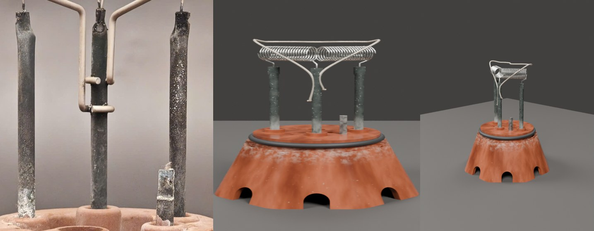
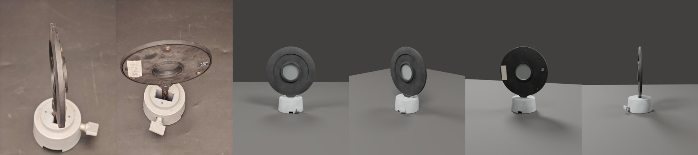
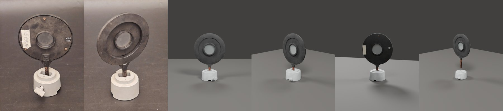

# Soát hình: chất liệu đèn sợi đốt v0.3 và mô hình thấu kính f = 200 mm

- Ngày: 15/11/2026 · Người kiểm: Claude Opus 5.5 (Cowork)
- Mô hình: `experiments/den-soi-dot/model/scene.glb` (0.2.0) và `experiments/thau-kinh-f200/model/scene.glb` (0.1.0, sửa 22:40: tách 2 cụm)
- Cách kiểm: đặt cạnh nhau ảnh thật và render Cycles 4 góc; đọc vật liệu trong GLB
- Kết luận: `can-sua` (đủ dùng để thử AR; chờ số đo thật và xem trên điện thoại)

## 1. Thư viện chất liệu dùng chung

`pipeline/4_dung_3d/chat_lieu.py` dựng chất liệu bằng node Blender rồi **nướng** ra 3 ảnh cho mỗi chi tiết: màu (sRGB), ORM (G = độ nhám, B = độ kim loại) và normal map. glTF chở được 3 ảnh này nên Unity hiển thị gần giống bản render. Ảnh xuất trong GLB là JPEG chất lượng 90.

| Công thức | Dùng cho | Đặc điểm |
|---|---|---|
| `bakelit_nau` | đế đèn | vân nâu đỏ kéo dọc, bụi trắng ở mép trên, xước nhỏ, hơi bóng |
| `kim_loai_gi_than_chi` | 3 cột dẫn | xám đen than chì, gỉ loang, chân cột bạc màu |
| `kim_loai_bac_xin` | cọc ngắn | kim loại bạc xỉn |
| `son_xam` | đế + núm vặn của giá thấu kính | sơn xám mờ, mép mòn lộ kim loại, bụi |
| `thep_gi_set` | cần giá thấu kính | thép tròn gỉ nâu |
| `nhua_den_bui` | đĩa, kẹp, vành kính | đen mờ, loang bụi, xước |

Sửa lỗi quan trọng: sau khi gộp nhiều khối thành một, gốc toạ độ của khối bị lệch nên mặt nạ theo độ cao (bụi mép đế, phần bạc màu ở chân cột) đặt sai chỗ. `join()` nay đưa gốc về gốc thế giới.

## 2. Đèn sợi đốt v0.3

- Đế: 8 mặt có vát cạnh, vân bakelit, bụi ở mép trên → bớt cảm giác "nhựa".
- Cột dẫn: chuyển từ xám sáng sang xám đen gỉ, chân cột bạc màu như ảnh. Đầu cột dập dẹt vừa phải hơn (1,22 × 0,62).
- Dây đỡ: be xám, mờ.
- GLB: 1 039 kB, ~20 800 tam giác, cao 0,147 m (với D = 0,12 m ước lượng).

Còn lệch: màu đế trong render hơi cam hơn ảnh; cột dẫn còn hơi ánh xanh. Chỉnh tiếp khi xem trên điện thoại (ánh sáng AR khác ánh sáng render).

## 3. Thấu kính hội tụ f = 200 mm

Script: `pipeline/4_dung_3d/thau_kinh_blender.py`. Gói: `experiments/thau-kinh-f200/` (bản nháp 0.1.0).

Dựng từ 25 ảnh trong `01_Anh_Da_Goc/Thau-kinh/`. Mọi kích thước tính theo **Dd** = đường kính đĩa đen (ước lượng 0,12 m):

| Bộ phận | Tỉ lệ | Chất liệu |
|---|---|---|
| Đế trụ thuôn | cao 0,27 Dd, bán kính đáy 0,26 Dd, đỉnh 0,235 Dd; lỗ vuông, rãnh đáy, 2 lỗ nhỏ | kim loại sơn xám |
| Núm vặn cánh | ở cao 0,10 Dd | kim loại sơn xám |
| Cần | bán kính 0,02 Dd | thép gỉ |
| Kẹp chữ V | cao 0,09 Dd, chân cắm vào lỗ vuông | nhựa đen |
| Đĩa | dày 0,04 Dd, mặt trước lõm bậc (bán kính 0,36 Dd) | nhựa đen |
| Vành kính | bán kính 0,205 Dd | nhựa đen |
| Kính | bán kính 0,17 Dd | thuỷ tinh trong (alpha 0,1) |
| Mặt sau | 2 đinh tán đồng, nhãn đen "+200 mm", giấy dán | — |

**Kính dựng theo vật lí**: hai mặt lồi đối xứng, bán kính mặt cong R = 2(n − 1)f = 2 × 0,52 × 200 mm = **208 mm** (n = 1,52 giả định). Với bán kính kính 20,4 mm và mép dày 1,4 mm, tâm kính dày **3,4 mm**. Khi đổi `--f` hoặc `--n`, độ cong tự đổi theo.

Kết quả: GLB 751 kB, ~16 900 tam giác, cao 0,156 m. Vật liệu kính trong GLB: `alphaMode = BLEND`, alpha 0,10.

Còn lệch:

- Bản render Cycles vẽ kính hơi trắng đục; trong GLB kính vẫn trong suốt (đã kiểm tra `alphaMode`). Cần xem trên điện thoại.
- Núm vặn trong ảnh to và vuông hơn; mặt trên đế có gờ bậc chưa dựng.
- Số "02006.55" khắc dưới đáy chưa dựng (không cần cho bài học).

## 3b. Sửa sau góp ý của thầy (22:30): tách 2 cụm, lộ que

Thầy chỉ ra: thấu kính bị tụt vào đế, trong khi thật ra thấu kính có **que kim loại** làm chân, cắm vào **đế kẹp** và được núm vặn giữ lại. Xem lại ảnh 19 và 25 thì đúng như vậy: đế có gờ nổi và lỗ chữ nhật xuyên suốt, que gỉ Ø khoảng 0,066 Dd nhô khoảng 0,10 Dd, trên đầu que là khối kẹp đứng rồi mới loe chữ V.

Quyết định: **tách thành 2 nút gốc trong cùng một GLB** (`DeKep`, `ThauKinh`), chưa tách thành 2 file. Lí do:

- Đúng với dụng cụ thật: độ cao quang tâm chỉnh được bằng cách nới núm vặn, nâng hạ que. Khi ghép thấu kính với nguồn sáng và màn chắn trên cùng trục chính, phải chỉnh được độ cao này.
- Nút "Tách rời" trong app có thứ để tách.
- Đế kẹp là loại dùng chung cho nhiều dụng cụ quang (màn chắn, giá nguồn sáng). Script đã tách riêng phần đế, nên sau này xuất được đế thành một mô hình dùng chung.
- Vẫn một file cho mỗi gói nên không phải đổi định dạng gói.

Kết quả: GLB 801 kB, ~17 700 tam giác, cao 0,178 m, quang tâm cao 11,8 cm. Nút `ThauKinh` có gốc ở đáy que, nút con `TamQuang` ở quang tâm, `extras` ghi f, n, R, bán kính kính (chỉ để app hiển thị; nguồn chuẩn vẫn là `experiment.json` khi thầy duyệt thêm trường).

## 4. Cần thầy đo

| Dụng cụ | Đo gì |
|---|---|
| Đèn sợi đốt | đường kính đáy đế, chiều cao tới đỉnh dây đỡ |
| Thấu kính | đường kính đĩa đen, đường kính phần kính, chiều cao đế |

Có số đo thì chạy lại script với `--D` / `--Dd`, mô hình đúng kích thước thật.
