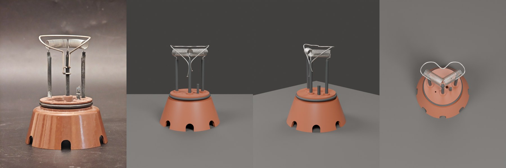

# Soát hình: mô hình 3D đèn sợi đốt (bản 0.1.0)

- Ngày: 15/11/2026 · Người kiểm: Claude Opus 5.5 (Cowork)
- Mô hình: `experiments/den-soi-dot/model/scene.glb` (549 kB, khoảng 21 000 tam giác)
- Nguồn: 26 ảnh trong kho `01_Anh_Da_Goc/Den-soi-dot/`
- Cách dựng: script Blender `pipeline/4_dung_3d/den_soi_dot_blender.py`

## Vì sao dựng bằng script, không quét ảnh

Đế nhựa nâu mờ thì quét ảnh được, nhưng sợi tóc (hai ống lò xo) và dây đỡ chỉ dày 1–2 mm: quét ảnh và AI tạo 3D đều làm đứt hoặc dính các chi tiết này. Vật có hình tròn xoay và dây uốn theo quy luật nên dựng bằng script cho kết quả sạch, nhẹ, sửa được bằng tham số.

## Kết quả so với ảnh thật

| Bộ phận | Khớp | Ghi chú |
|---|---|---|
| Đế nón cụt rỗng, 8 khe vòm | Có | Ảnh thật có các mặt phẳng dọc (gần bát giác); bản dựng là nón trơn |
| Gioăng cao su đen, đĩa nhựa có lỗ | Có | Vị trí lỗ trên đĩa là gần đúng |
| 3 trụ kim loại (giữa phía trước, hai bên lùi sau) + cọc ngắn | Có | |
| Sợi tóc: 2 ống lò xo xếp chữ V, treo trên đầu trụ | Có | Số vòng 19 mỗi ống, đếm trên ảnh |
| Dây đỡ hình trái tim nhìn từ trên | Có | |
| Đoạn dây đỡ đi lên từ trụ giữa | Chưa | Ảnh thật: chạy thẳng đứng sát trụ rồi mới toả ra; bản dựng toả ra sớm |
| Màu | Gần | Đã chỉnh theo ảnh; trụ thật có vết gỉ, chưa mô tả |

## Kích thước

Toàn bộ kích thước tính theo đường kính đáy đế D. **D = 0,12 m là ước lượng**, chưa đo. Chiều cao mô hình hiện là 14,7 cm. Đo D bằng thước rồi chạy lại script với `--D <giá trị>` để có tỉ lệ 1:1.

## Kết luận

`dat` cho mục đích thử AR (GĐ 1). Chưa dùng làm bản giảng dạy cho tới khi có số đo D thật và sửa đoạn dây đỡ.
